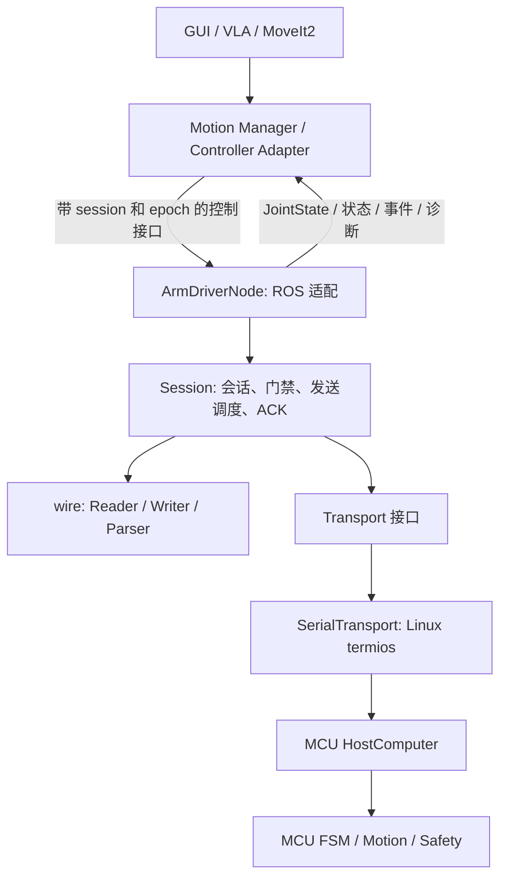
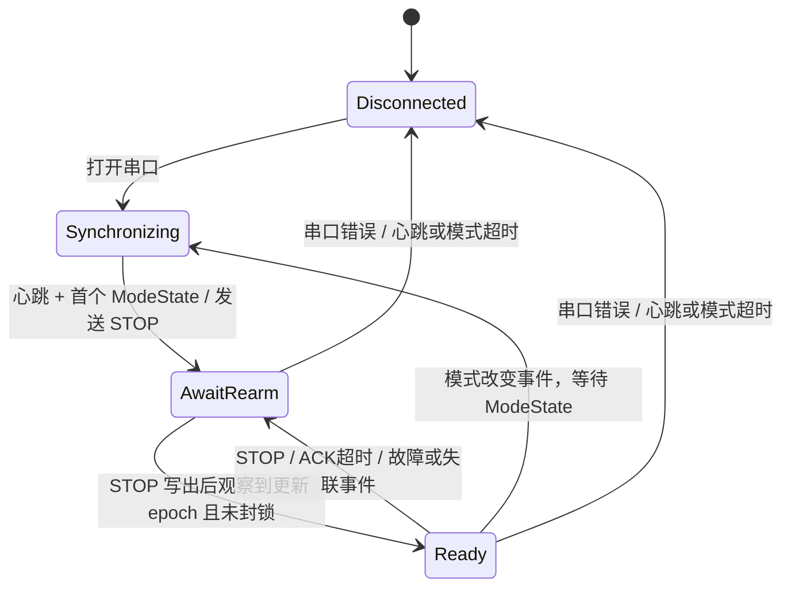

# ENG26 上位机通信节点架构

本目录以 ROS 2 Humble 公共 API、C++17、Linux 为兼容基线。目标是同一份源码分别在 Ubuntu 22.04 实机和 Ubuntu 26.04 开发环境所安装的 ROS 2 中编译，不保证跨发行版二进制 ABI，也不要求在 26.04 上安装 Humble。本次交付未编译、未执行 C++ 测试、未上机验证。

## 1. 依据与边界

协议依据按优先级排列：

1. 当前工作树的 `App/Devices/HostComputer/HostComputerCore.cpp`、`HostProtocol.hpp`、`HostTypes.hpp`、`TrajectoryReceiver.hpp`。
2. `tests/host_computer/host_computer_test.cpp` 的行为合同。
3. `App/Devices/HostComputer/README.md` 的协议表。
4. 根目录 `hostcomputer.md` 的总体架构设想。

现有通信文件包含开发中的修改，本实现以当前工作树为准。ROS 代码独立放置，不链接 ETL、SheriffOS、HAL，不改写这些下位机文件。

| 设计文本或易误解之处 | 当前固件事实及上位机处理 |
| --- | --- |
| 文本称单字节 cmd | 帧头 cmdid 是小端 u16；ACK 内 requestCmd 单独使用 u8 |
| len 可能理解成 payload 长度 | len 包含整帧，7..1024；checksum 只累加 payload |
| ModeState 的简化字段 | 严格读取 10 字节，包括 online、controlBlocked、snapshotValid |
| 接收直接面向字节流 | MCU core 接收完整帧；PC 的 Parser 自行处理串口粘包、分片和噪声 |
| 心跳恢复即恢复控制 | STOP/断线后 MCU 必须更新 epoch；PC 还有本地 session_id 门禁 |
| ACK=执行成功 | ACK(Ok) 只表示通信接受；Start/Cancel/Hold/ClearFault 只进入 FSM 队列 |
| TrajectoryFinished.detail 是轨迹 ID | 尚未规定；原样发布，绝不据此宣布 FollowJointTrajectory 成功 |
| Cancel 已释放轨迹 | MCU Cancel 只入 FSM 队列；上传 Action 取消使用 STOP 并等待新 epoch |
| 接收动作已接入业务 FSM | 当前已接入 PerformanceState 的 down/Vla servo、STOP/Hold 和 RoboArmThread 双臂快照；轨迹执行与 ClearFault 业务仍未接入 |

默认串口为 921600、8N1、无软/硬件流控，来自 H723 BSP 的 `USART10.BaudRate=921600` 配置；部署时仍须核对实际使用的板级配置。

## 2. 分层与依赖



| 单元 | 职责 | 不依赖 |
| --- | --- | --- |
| `eng26_arm_interfaces` | 业务消息、命令服务、上传 Action | driver、固件 |
| `protocol.hpp/.cpp` | 逐字段小端编解码、binary32、流重组、校验 | ROS、串口设备 |
| `Transport` / `SerialTransport` | 单所有者非阻塞字节 I/O、独占串口、错误与 RAII 关闭 | ROS、机器人模式 |
| `Session` | 心跳、epoch/session、STOP、ACK、有限队列、最新值缓冲 | ROS、MoveIt、线程框架 |
| `ArmDriverNode::Impl` | QoS、时间戳检查、关节映射、上传状态机、诊断 | IK、轨迹插值、碰撞检查 |

库 `eng26_host_core` 可单独链接和注入模拟 `Transport`；ROS 节点同时导出组件与独立可执行程序。实体名称可 remap/namespace；公共 C++ 头文件只暴露节点构造入口，节点实现使用 PImpl。

上层 Motion Manager 应是 driver 唯一的运动命令生产者，负责 GUI/VLA/MoveIt 的控制源仲裁、关节限位、整段碰撞检测、规划、限速与复位流程。driver 校验模式、字段、会话和新鲜度；这些校验不等同于运动安全检查。`safety_flags` 没有自行推断位含义，必须结合 `snapshot_valid` 解读。

## 3. ROS 接口与执行模型

连续目标用 topic，短命令用 service，分块上传用可反馈、可取消的 action。这与 ROS 2 官方的 [接口职责说明](https://docs.ros.org/en/humble/Concepts/Basic/Interfaces-Topics-Services-Actions.html)一致。`~/` 表示节点私有名称，默认节点为 `/arm_driver`。

| 名称 | 类型 | 语义 / QoS |
| --- | --- | --- |
| `~/servo_target` | `JointCommand` | PcDebug/Vla，rad；best effort、volatile、depth=1 |
| `~/joint_jog` | `JointCommand` | PcDebug，rad/s；同上 |
| `~/cartesian_jog` | `CartesianJog` | PcDebug；同上，frame=base/tool |
| `~/command` | `Command.srv` | Hold/ClearFault/Start/Cancel；响应仅是本地排队结果 |
| `~/stop` | `Stop.srv` | 无 epoch/模式约束，优先 STOP；响应不是物理停止确认 |
| `~/upload_trajectory` | `UploadTrajectory.action` | 位置轨迹 → Begin/Chunk/Commit，成功=Commit ACK(Ok) |
| `joint_states` | `sensor_msgs/JointState` | 14 轴，右 7 左 7；SensorDataQoS，effort 留空 |
| `~/joint_telemetry` | `JointTelemetry` | 保留 MCU 时间戳与 epoch；SensorDataQoS |
| `~/state` | `DriverState` | 10 Hz 及会话变化；包含心跳镜像的左右夹爪参考状态；reliable、transient local、depth=1 |
| `~/events` | `RobotEvent` | 原始业务事件；reliable、volatile、depth=64 |
| `~/command_results` | `CommandResult` | 本地失败/替换、ACK、超时、失效、STOP 写出；reliable、volatile、depth=64 |
| `diagnostics` | `diagnostic_msgs/DiagnosticArray` | 2 Hz，主机及 MCU 计数、链路/模式/反馈状态 |

传感器状态选 best effort、控制消息不使用 transient local，以减少旧数据的重放；状态镜像允许新订阅者获得最近状态，但仍需检查其时间戳。QoS 匹配约束见 [ROS 2 QoS 文档](https://docs.ros.org/en/humble/Concepts/Intermediate/About-Quality-of-Service-Settings.html)。事件/result 的可靠传输不意味着跨进程重启持久化，客户端必须提前订阅并保留自己的业务记录。

所有回调属于同一个默认 MutuallyExclusive callback group。定时器、订阅、服务和 Action 回调只做有界工作，不启动 detached thread、不在回调中等待 future、不嵌套 spin。即使装进 MultiThreadedExecutor，该节点的会话状态仍由一个回调顺序访问，符合 [callback group 语义](https://docs.ros.org/en/jazzy/How-To-Guides/Using-callback-groups.html)。这不是硬实时节点；严苛调度需求下建议独立进程和隔离执行器，避免业务回调影响串口服务。

2 ms wall timer 每轮最多读取四个 1024 字节块、解析缓冲内完整帧并做一次非阻塞 write。Parser 缓冲最多 4096 字节，坏帧从一个字节后重新寻找 SOF，半帧无新数据 100 ms 后清除。read/write 无数据立即返回，写失败或部分写超时关闭连接。应用层保存未发送余量，不调用阻塞 `tcdrain`。

## 4. 会话与命令生命周期



- MCU 决定 mode/epoch；PC 没有 SetMode 服务。更新 epoch 时清空旧请求，旧 Event 不覆盖权威 ModeState。
- 每次进程启动随机生成 64 位 session_id，连接、模式变化、STOP 或失效时轮换；上层从新鲜 DriverState 复制它。session_id 只存在于 ROS 侧，不更改固件帧。
- 初次连接发送 STOP，然后等待 **STOP 写出以后** 的新 MCU epoch。这解决上位机重启但 MCU 保留 seq/trajectory_id 的情况。该过程可能中断既有控制，部署者应将启动驱动视为建立新的控制会话。
- `motion_ready` 是通信准备就绪提示，额外要求当前会话有持续更新的关节反馈。不能据此跳过碰撞/限位检查。
- ROS 命令必须带原始创建时间，拒绝零、未来、过期时间戳；同一 ROS 图中的时钟需同步。排队剩余寿命从原始创建时刻扣除，不重新赋予完整寿命。物理串口配置使用 `use_sim_time=false`。
- 传输超时、ACK 超时、反馈存活判断使用 `steady_clock`。ROS clock 用于应用时间戳与控制输入检查；MCU `timestampMs` 单独保留，绝不假装已经时钟同步。
- MCU 重复上传同一 timestamp 的 JointState 不刷新反馈寿命。MCU uptime 回退（排除 u32 自然回绕）触发重新握手。
- MCU→PC 心跳为 `uptimeMs:u32 + leftGripper:u8 + rightGripper:u8`，夹爪枚举为 Close/Open/Free/Suspend=0/1/2/3；PC→MCU 心跳仍只发送 uptime。ROS 仅在 `heartbeat_fresh` 时使用夹爪参考状态，断线后将其置为 Unknown=255。

发送顺序：已开始的部分帧 → STOP → 到期心跳 → 离散命令 → 轮转的实时最新值。已经写入的帧不能从中间插入 STOP；停止延迟仍受 OS/串口缓冲及 MCU 调度影响，STOP 不是硬件急停。

普通命令只有一个等待 ACK 的窗口，离散待发队列最多 8 条，三个实时目标各保留一个最新值。发送前再次验证 session/epoch/模式与 TTL。连续服务调用可能延后实时目标；Motion Manager 应按 MCU 模式只启用所需控制源。

seq 为三个独立实时计数器、一个四种离散命令共享计数器和一个上传 ACK 关联计数器；符合 MCU 去重边界，避免高速实时流导致低频 Hold 的 seq 跳跃超过半区间。16 位计数按固件回绕规则使用。`client_id` 是业务关联标签，`ticket` 是本进程请求标识，均不是幂等键。

ACK 严格匹配 seq、requestCmd、epoch；StaleEpoch/Offline 错误允许报告更高的 MCU epoch，此时等待对应的新 ModeState，不对 MCU 的新模式追加 STOP。已知的新模式事件/ACK 也不能被排队的旧 ModeState 撤销。只处理结果码 0..12。上传 ACK 的 detail 还必须匹配 trajectory_id。错误 ACK、重复 ACK 不推进当前事务。

| `CommandResult.outcome` | 上层应理解为 |
| --- | --- |
| ACK + MCU_OK | 通信已接受；动作未必执行 |
| ACK + 非零 | MCU 明确拒绝，查看结果码 |
| REJECTED | 本地校验/排队/发送前过期，未开始发送此请求 |
| SUPERSEDED | 被更新的最新值替换，或 STOP 合并 |
| TIMEOUT | ACK 未到，是否接受/执行未知；本节点不自动重传 |
| INVALIDATED | 会话/STOP/传输错误导致取消等待，已发送的内容可能已生效 |
| WRITTEN_UNCONFIRMED | STOP 字节交给 OS；协议无 ACK，物理停止未知 |

本地接口校验失败的 ticket=0；进入 Session 后即有 ticket。状态、事件、ACK 可能先于 service 响应被其他线程收到，客户端应按 ticket/client_id 保存事件并关联，不能依赖跨 topic/service 顺序。

## 5. 轨迹设计

Motion Manager 传入标准 `trajectory_msgs/JointTrajectory`。driver 通过名字映射到右 7 / 左 7 wire 顺序；名称顺序任意，要求选中臂的全部关节，允许同时给齐 14 个关节。未选择且未给出的臂数组填有限的零，MCU 按 mask 忽略。

严格验证：1..256 点、无重复/未知关节、位置数组长度、有限且能表示成 binary32、时间精确到整数微秒、u32 微秒上限、严格递增、首点允许 0。`trajectory.header.stamp` 必须为零，执行时间交由 Start。含 velocity/acceleration/effort 的轨迹会拒绝，因为 wire 无法传输这些约束；上层应明确重采样/重定时，不能静默丢弃 MoveIt 导数。

```text
Goal → Begin → ACK → Chunk[0] → ACK → … → Chunk[n] → ACK → Commit → ACK
                                                                          ↓
                                                                Action 成功 READY
                                                                          ↓
                                                        上层决定是否调用 Start
```

每块最多 4 点，每次仅上传一个等待 ACK 的块；业务 Action 提供阶段与已确认点数反馈，总体超时 120 秒。默认各块 ACK 超时为 200 ms；因此无需依赖 MCU Receiving 的 2000 ms 超时来检测故障。丢失 ACK 后不重发重复 chunk，不重用旧 ID 猜测完成状态；终止事务并发送 STOP，等待重新授权。即使先收到 Commit ACK，如果同一轮接收随后观察到会话变化，也不会再将旧轨迹报告为可用的 READY。

同一时刻只接受一个上传 Action。上传期间普通 command service 拒绝进入，以避免 Hold/Start 等破坏上传状态；独立 STOP 可随时调用。Action cancel 先在本机取消上传，在仍属于原会话时发送 STOP，结果明确报告 MCU 停止/释放未确认。取消与 Commit ACK 同时到达也按取消处理。若 MCU 已切换到新模式/epoch，旧事务只失效退出，不向新会话追加清理用的 STOP。

上传成功后记录本会话的 trajectory_id，仅允许 Start/Cancel 操作这个 ID。Start 在入队时预留，防止客户端连续两次启动；明确拒绝时解除预留，ACK 超时需重新授权。Cancel ACK 不会把 Ready 储存宣告为已释放；后续新上传用新 ID 的 Begin，让 MCU 的 TrajectoryBusy/Ok 决定是否有空间。

`FollowJointTrajectory` 属于上层 Controller Adapter：它需要将上传、Start、真实执行反馈、路径/目标容差、执行超时、取消结果组合为完整语义。本通信节点不虚构 `FollowJointTrajectory` 成功结果。要完成这个适配，MCU 业务必须明确：开始/完成/失败/取消/释放事件如何关联 epoch+trajectory_id，状态如何反映执行进度。原始 RobotEvent 和 JointTelemetry 已保留所需接入口；以后可以扩充协议而不让 GUI/VLA 直接处理串口字节。

## 6. 部署前必须接上的固件业务

当前 `HostLinkCom` 提供 UART10 传输和周期 update；PerformanceState 已接入右拨杆 middle 回零、down/Vla 的 servo 消费及 STOP/Hold，RoboArmThread 每轮更新有效双臂 q（dq 暂为 0）。模式通过 `HostArmMode.hpp` 更新并递增 epoch，采样使用带锁的 `controlState()`。以下是完整业务集成核对表，其中模式、快照及 VLA 控制已有实现，轨迹执行与 ClearFault 尚未实现：

1. 初始化及每次模式变化/重新授权时调用 `onModeChanged()`，包括 STOP/失联后的同模式 rearm。
2. 优先消费 `takeStopRequest()`，并检查 `isOnline()`，实际停止已取走的运动目标。
3. 提交当前 epoch 的 `setRobotSnapshot()`，timestampMs 随实际采样推进。
4. 消费实时 mailbox 及 `tryPopCommand()`，做安全检查后执行 Hold/ClearFault/Start/Cancel。
5. 消费 Ready 轨迹，结束/取消后 `releaseTrajectory()`；定义并可靠上报带轨迹关联的业务事件。
6. 核对实际 UART10 TX DMA、中断与接收时间基准；ROS 收到心跳不证明运动层已经接好。

此边界来自仓库当前实现，不是 ROS 端可以通过 ACK 猜测补齐的功能。

## 7. 验证范围

新增 GTest 提供协议固定向量、分片/粘包、坏校验、噪声、半帧超时、长度、序号回绕、启动重授权、ACK 关联、会话切换、ACK 超时、STOP 部分帧处理、执行器停顿、队列背压、各类 seq 独立性测试。测试源码供切换到 ROS/Linux 环境后执行，本次不编译运行。

本次只做文件/接口/依赖/参数及固件协议的静态检查。切换环境后的编译、ROS Action 生命周期测试、串口 PTY/实机断线测试、MCU FSM 联调仍是验证项。没有把静态检查表述为跨发行版编译或上机通过。
